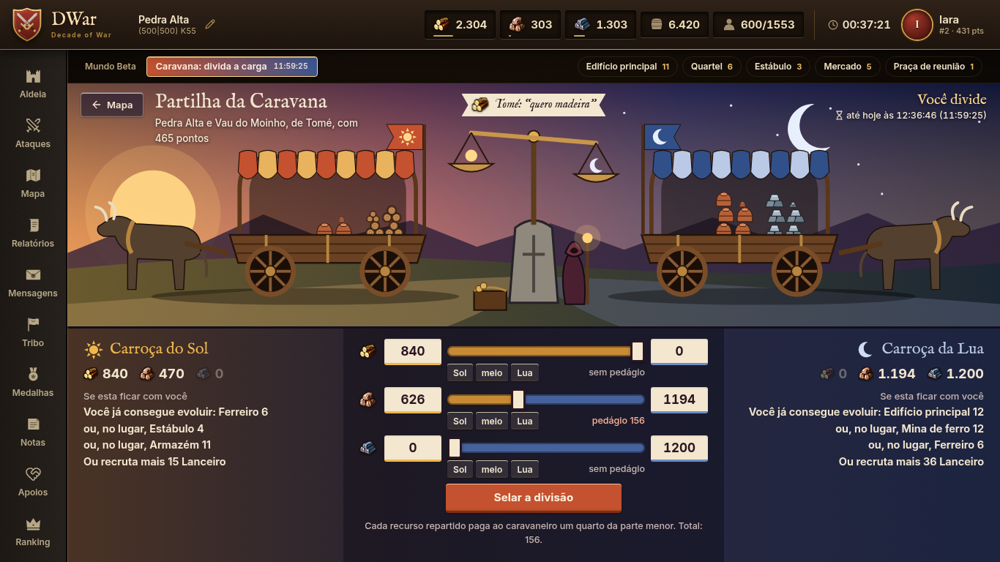

# Partilha da Caravana

Uma caravana para entre duas aldeias. Uma divide a carga em duas carroças, a vizinha escolhe uma, e
quem dividiu fica com a outra. A pergunta da mecânica: como oferecer ao rival uma escolha que também
seja boa para mim, sabendo que a decisão final é dele?

## Regras

| Regra | Valor |
| --- | --- |
| Quem participa | Jogadores com sessão válida e aldeias a até 20 campos, do par mais próximo ao mais distante |
| Frequência | Uma por jogador, com 20 h de descanso, e só com o portão livre |
| Carga | 60% da média geométrica dos dois armazéns, com proporção sorteada entre os recursos |
| Papéis | Quem escolheu da última vez com aquele vizinho agora divide |
| Pedágio | Em cada recurso repartido, a parte menor paga 25% |
| Diferença mínima | Cada carroça leva ao menos 60% de algum recurso |
| Flâmula | Quem escolhe pode dizer o que quer antes da divisão; pode ser blefe |
| Prazos | 12 h para dividir e 12 h para escolher |
| Ausente ao dividir | O caravaneiro põe o recurso maior numa carroça e o resto na outra; o vizinho escolhe |
| Ausente ao escolher | Leva a carroça com mais do recurso da flâmula; sem flâmula, a mais pesada |
| Entrega | A carroça espera no portão, sem prazo. Descarrega o que couber no armazém |
| Conquista | A participação é da aldeia: quem a possui age por ela e recebe a carroça |

Cada jogador vê só o próprio estado, a carga, a flâmula, os pontos públicos do vizinho e o que ambos
viveram em partilhas anteriores. Os demais jogadores veem a caravana no mapa e entre quem ela está.

## Por que pedágio e diferença mínima

Simulação com os custos reais dos edifícios, 120 aldeias por linha. "Metade" é dividir tudo ao meio.

| Aldeias | Metade é ótima, sem pedágio | Metade é ótima, pedágio de 25% |
| --- | --- | --- |
| nível 8 | 30% | 0% |
| nível 14 | 42% | 3% |
| nível 20 | 39% | 1% |

Carroças iguais ainda eram possíveis e anulavam a escolha do vizinho; a diferença mínima as proíbe.

## Jogar com duas contas

`pnpm demo:caravana` usa o banco separado `dwar_caravana` e abre em http://localhost:5200. Subcomandos
em outro terminal: `nova`, `prazo`, `trocar`. `recomecar` volta ao início.
